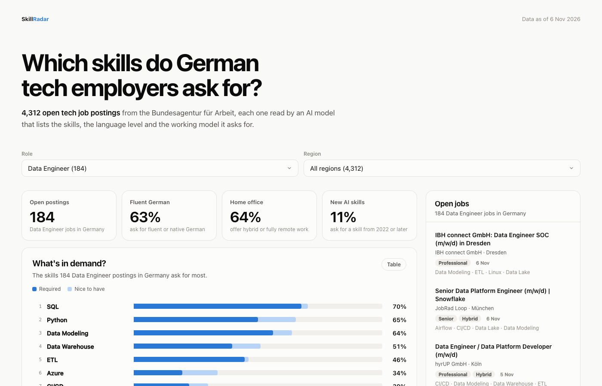
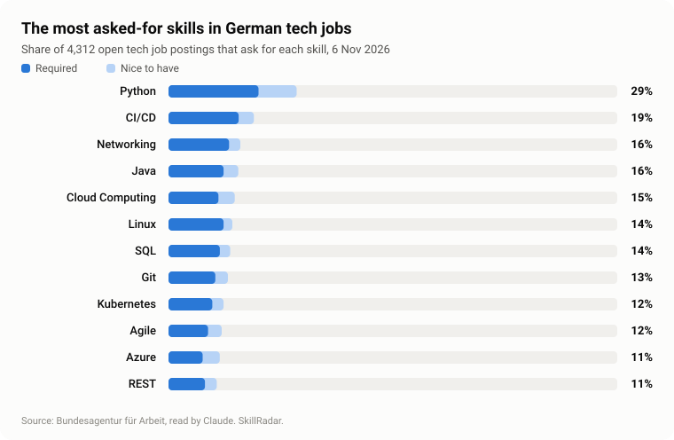
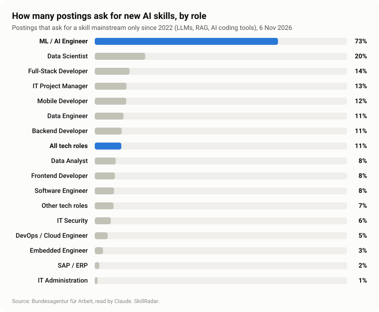
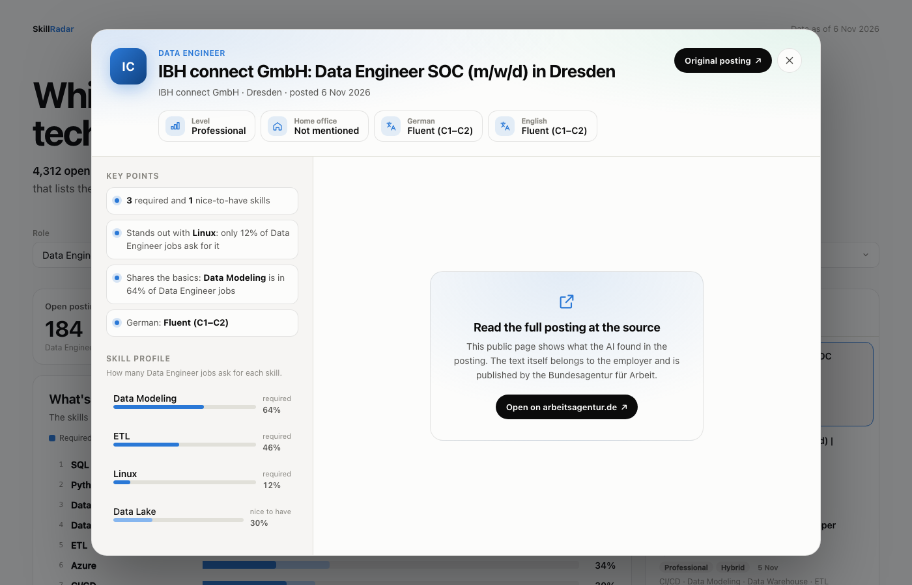

# SkillRadar

[](https://github.com/OmidRasouli22/skillradar/actions/workflows/ci.yml)

**Which skills do German tech employers really ask for?**

**[Open the live site →](https://omidrasouli22.github.io/skillradar/)** · updated every day



## The story

When you look for a tech job in Germany, every posting is a small wish list. One wants
Python and Kubernetes, the next wants SQL and fluent German, a third says Docker "would be
nice". Reading a few of them is easy. But which skills matter across thousands of postings,
and which of them are a must rather than a plus?

SkillRadar answers that by reading every posting, every day.

Each morning my Mac downloads the open tech job postings from the Bundesagentur für Arbeit,
Germany's official job portal, through its public API. Contact details are removed first.
Then an AI model, Claude, reads each posting the way a careful recruiter
would and writes down a short, fixed answer: the role, the seniority, home office, the
languages, and every technical skill, each one marked as *required* or *nice to have*.

Those answers become clean tables, the tables become a small website, and a fresh copy of
the site goes online every day.

## What the data says

<picture>
  <source media="(prefers-color-scheme: dark)" srcset="assets/images/top-skills-dark.svg">
  
</picture>

- **Python leads.** 29% of all tech postings ask for it, and 20% require it.
- **Every role has its own core.** For Data Engineers it is SQL (70%), Python (65%) and data
  modeling (64%). For ML and AI engineers it is Python, LLMs and machine learning.
- **The AI wave is already here.** 11% of all tech postings ask for at least one skill that
  barely existed in job ads before 2022: LLMs, RAG or an AI coding tool. For ML and AI
  engineers it is 73%. GitHub Copilot appears in 41 postings, Claude Code in 33.
- **German still matters.** 57% of postings ask for fluent or native German. About a
  quarter don't mention German at all.
- **Hybrid is normal, fully remote is rare.** 58% offer hybrid work, only about 5% are
  fully remote.

<picture>
  <source media="(prefers-color-scheme: dark)" srcset="assets/images/ai-wave-dark.svg">
  
</picture>

*From 4,312 open tech job postings by 1,366 employers, 6 November 2026.*

## Every job as a profile



Click a job and it opens as a short profile: the key facts, what makes this job different
from others in the same role ("only 12% of Data Engineer jobs ask for Linux"), and how
common each of its skills is. A button leads to the original posting.

## Run it yourself

```sh
uv sync
cp .env.example .env                 # add your ANTHROPIC_API_KEY
uv run skillradar-schedule install   # the daily job, every day at 08:00
cd web && npm install && npm run build && cd ..
uv run skillradar-web                # the page at http://127.0.0.1:8000
```

Every command, table and setting is described in
[How SkillRadar works](HOW_IT_WORKS.md).
